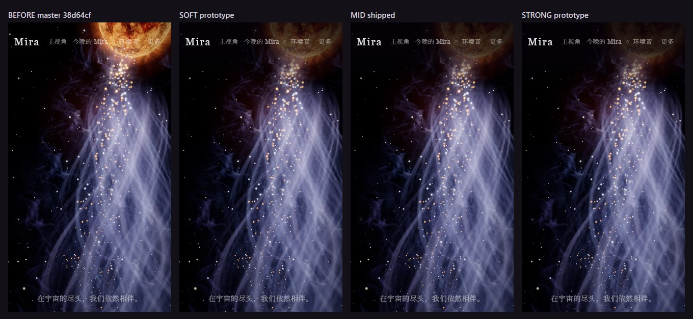
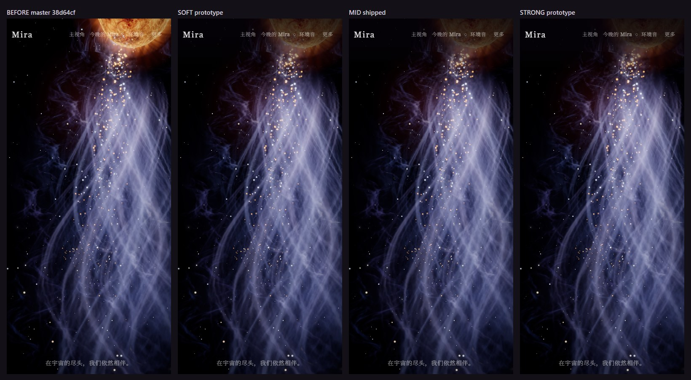

# #137 竖屏顶栏衬底：前后对比证据

每张前后图左边是改动前（master `38d64cf`），右边是改动后（PR #140）。

## 截图条件

- 本机 headless Chromium，dpr 1。手机画幅用 mid 档（手机的实际档位），桌面用 high 档。
- 走 `experiments/baseline-harness.mjs` 的同一套流程：`?capture=1` 冻结时间与镜头，纪元 `2026-04-10T12:00:00Z`（亮度极大）。near 是 harness 预设的放大机位。
- 拍摄前在画面上拖拽一次，让「今晚的 Mira」进入顶栏。near 机位下「主视角」同时出现，衬底随之出现。
- 竖屏 390×844 与 320×568，横屏 844×390，桌面 1440×900，另有一组竖屏 390 开启减少动态效果，和两组竖屏英文界面（在「更多」面板里切到英文后拍）。

## 对比度

逐字形像素计算。对每个标签的每个字形像素，取它背后那一像素作背景，算标签颜色（白，55% 不透明度）压在它上面的 WCAG 对比度，再取中位数。

| 画面 | 顶栏标签 | 改动前中位数 | 改动后中位数 | 改动后低于 4.5:1 的字形像素 | 前后不同的像素 |
| --- | --- | --- | --- | --- | --- |
| [竖屏 390，near](portrait390-near-before-after.png) | 主视角 | 6.26:1 | 6.26:1 | 0% | 46788（14.21%） |
|  | 今晚的 Mira | 2.69:1 | 5.91:1 | 0% |  |
|  | 环境音 | 2.04:1 | 5.67:1 | 0% |  |
|  | 更多 | 2.23:1 | 5.76:1 | 0% |  |
| [竖屏 320，near](portrait320-near-before-after.png) | 主视角 | 6.27:1 | 6.26:1 | 0% | 38441（21.15%） |
|  | 今晚的 Mira | 6.15:1 | 6.26:1 | 0% |  |
|  | 环境音 | 1.86:1 | 5.54:1 | 0% |  |
|  | 更多 | 2.19:1 | 5.72:1 | 0% |  |
| [竖屏 390，默认构图](portrait390-default-before-after.png) | 今晚的 Mira | 6.27:1 | 6.27:1 | 0% | 0 |
|  | 环境音 | 6.27:1 | 6.27:1 | 0.8% |  |
|  | 更多 | 6.27:1 | 6.27:1 | 0% |  |
| [竖屏 320，默认构图](portrait320-default-before-after.png) | 今晚的 Mira | 6.27:1 | 6.27:1 | 0% | 0 |
|  | 环境音 | 6.27:1 | 6.27:1 | 0% |  |
|  | 更多 | 6.27:1 | 6.27:1 | 0% |  |
| [竖屏 390，near，减少动态效果](portrait390-near-reduced-before-after.jpg) | 主视角 | 6.26:1 | 6.26:1 | 0% | 46788（14.21%） |
|  | 今晚的 Mira | 2.69:1 | 5.91:1 | 0% |  |
|  | 环境音 | 2.04:1 | 5.67:1 | 0% |  |
|  | 更多 | 2.23:1 | 5.76:1 | 0% |  |
| [横屏 844，near](landscape844-near-before-after.jpg) | 全部 6 个标签 | 6.26:1 到 6.27:1 | 6.26:1 到 6.27:1 | 最多 1.8% | 0 |
| [桌面 1440，near](desktop1440-near-before-after.jpg) | 全部 6 个标签 | 6.27:1 | 6.27:1 | 0% | 0 |
| [竖屏 390，near，英文](portrait390-near-en-before-after.jpg) | Main view | 6.27:1 | 6.26:1 | 0% | 46788（14.21%） |
|  | Tonight's Mira | 6.13:1 | 6.26:1 | 0% |  |
|  | Ambient sound | 2.02:1 | 5.62:1 | 0% |  |
|  | More | 2.32:1 | 5.77:1 | 0% |  |
| [竖屏 320，near，英文](portrait320-near-en-before-after.jpg) | Main view | 6.27:1 | 6.26:1 | 0% | 64982（35.75%） |
|  | Tonight's Mira | 5.69:1 | 6.25:1 | 0% |  |
|  | Ambient sound | 2.07:1 | 5.85:1 | 0% |  |
|  | More | 6.23:1 | 6.26:1 | 0% |  |

默认竖屏、横屏和桌面上前后逐像素相同：衬底在这些状态下不存在。竖屏 390 默认构图下「环境音」那 0.8% 的字形像素改动前就压在一处亮背景上，与这次改动无关。像素差都在截图上算，JPG 那几行算的是编码前的截图。英文 320 宽那组不同的像素更多，是因为那里顶栏排成了两行（见下面第三点），衬底跟着变高。

## 深浅的取舍

同一冻结画面上的四联图：改动前，然后是浅、中、深三档。浅档和深档只做过原型（在冻结页面上注入样式，没有做成真实构建），中间档是已实现的那一份。

| 深浅 | 320 宽 near | 390 宽 near | 目检 |
| --- | --- | --- | --- |
| 浅（原型） | 环境音 4.84:1，约 11% 的字形像素低于 4.5:1 | 5.07:1 到 5.5:1 | 几乎意识不到，320 宽下字偏紧 |
| 中（已实现） | 环境音 5.54:1，更多 5.72:1 | 5.67:1 到 5.91:1 | 仍读作柔和暗角，字全部轻松可读 |
| 深（原型） | 6.01:1 到 6.26:1 | 6.06:1 到 6.16:1 | 能明确察觉上半屏有一层罩 |

「中」一行是上面第一张表里真实构建的数字。原型的中间档用 84% 和 68% 两个色标，实现取整成 85% 和 70%，原型量到的是 5.42:1 和 5.64:1。三档都没有硬边和条带。深浅是观看者的美术决定，合并前由观看者看图确认。

## 截图里看不到的四点

- 截图里衬底高约 122 像素。刘海手机上顶栏随安全区变高，衬底跟着变高，要在真机上看一眼。
- 568×320 的小屏横屏在窄屏断点之内，仍然不出现衬底。竖屏按「高大于宽」判定，场景和界面共用同一条规则。
- 宽度小于 640 且高大于宽的桌面窗口会按竖屏手机处理。紧凑栏本来就是这样判定的。
- 英文界面在 320 宽、镜头离开主视角时，顶栏排成两行（「More」落在第二行）。这是改动前就有的，和「竖屏手机上这一列始终一行」的约定不符，不在这次改动范围内。衬底跟着变高的顶栏走。
