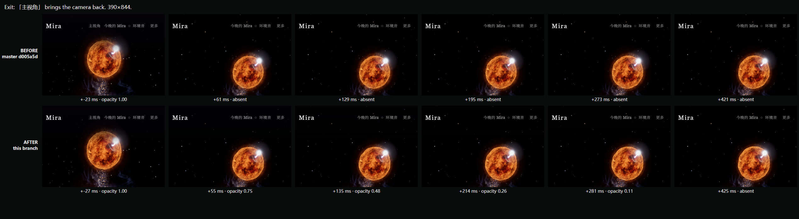
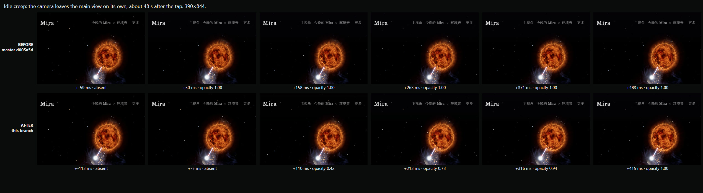
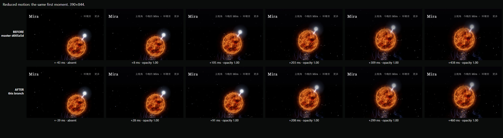

# #148 顶栏衬底淡入淡出：前后对比证据

改动前是 master `d005a5d`，改动后是本 PR。两者只在衬底出现和消失的那一下不同。淡入跑完之后，画面和改动前逐像素相同。

## 怎么拍的

全部由 `experiments/backing-fade-evidence.mjs` 生成，命令在最后。

- **稳态。** 走 `experiments/baseline-harness.mjs` 的同一套流程，冻结时间与镜头。纪元是 `2026-04-10T12:00:00Z`，亮度极大，和 #137 的证据同一个纪元。两份构建各起一个开发服务器，各拍四个画面，逐像素比较。
- **过程。** 两份生产构建各由 `serve-dist.mjs` 提供服务，用带真实 GPU 的无头 Chromium 走同一套输入。视口 390×844，dpr 1。页面从第一帧起每帧读一次衬底的 computed opacity，并记下它挂载和卸载的帧。每次截图都记下页面自己的时钟。两边都对齐到衬底挂载（或开始消失）的那一刻，每格标着「+多少毫秒」。
- **视频。** 用同一批帧。左边改动前，右边改动后。前 1.2 秒原速，后 4.8 秒四倍慢放。显示的始终是不晚于该时刻的最新一帧。

## 稳态：淡入跑完之后

| 画面 | 衬底 | 前后不同的像素 |
| --- | --- | --- |
| 竖屏 390×844，默认构图 | 两边都没有 | 0 / 329160 |
| 竖屏 390×844，near 机位 | 两边都有，opacity 1 | 0 / 329160 |
| 竖屏 390×844，near，减少动态效果 | 两边都有，opacity 1 | 0 / 329160 |
| 桌面 1440×900，near | 两边都没有 | 0 / 1296000 |


## 过程：出现和消失的那一下

每格是「距挂载（或开始消失）多少毫秒 · 当时的 opacity」。

| 时刻 | 改动前 | 改动后 |
| --- | --- | --- |
| 镜头离开主视角，本次到访的第一次拖拽 | +8 ms 就是 1.00 | −4 ms 时还没有。+93 ms 0.36，+190 ms 0.66，+303 ms 0.92，+453 ms 1.00 |
| 点「主视角」，回到主视角 | +61 ms 时已经消失 | +55 ms 0.75，+135 ms 0.48，+214 ms 0.26，+281 ms 0.11，+425 ms 消失 |
| 空闲缓移 | +50 ms 就是 1.00 | +5 ms 时还没有。+110 ms 0.42，+213 ms 0.73，+316 ms 0.94，+415 ms 1.00 |
| 减少动态效果，镜头离开主视角 | +8 ms 就是 1.00 | +28 ms 就是 1.00，没有渐变 |








视频在同一个文件夹里，`enter.mp4`、`exit.mp4` 和 `idle.mp4`。减少动态效果没有渐变，只有长条。

## 两点说明

- **按钮先到，暗影后到。** 「主视角」这个按钮仍然一帧出现，只有它后面的衬底在淡入。挂载后的头 0.1 秒里，按钮在，暗影还没到。按钮的出现方式不在本 PR 的范围内。
- **空闲缓移什么时候来。** 点过「主视角」之后，镜头先定格 10 秒（`RETURN_SETTLE_MS`），再等 30 秒的空闲计时，然后前移。实测「主视角」和衬底在点击后约 48 秒出现。结语在约 70 秒出现，顶栏随之退场。没点过「主视角」时，没有那 10 秒的定格。

## 重跑

```
npm run build   # 在两个检出里各跑一次
node experiments/backing-fade-evidence.mjs steady <改动前的检出> <改动后的检出> <输出目录>
node experiments/backing-fade-evidence.mjs strips <改动前的 dist> <改动后的 dist> <输出目录> "BEFORE|master d005a5d" "AFTER|this branch"
```

`strips` 要用 `channel: 'chromium'` 的 Chromium，视频还要 PATH 上有 ffmpeg。没有 ffmpeg 时只出长条。`sheets <输出目录> <左标签> <右标签>` 用已拍好的帧重排长条，不重新拍。

长条里的毫秒数每跑一次都会略有不同，因为每一帧的时间取决于当时的拍摄帧率。渐变的形状每次都一样。
