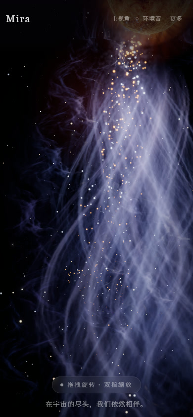
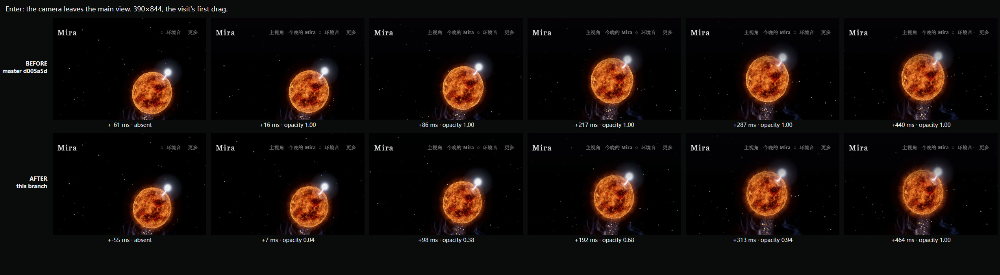

# #148 顶栏衬底淡入淡出：前后对比证据

改动前是 master `d005a5d`，改动后是本 PR。两者只在衬底出现和消失的那一下不同。淡入跑完之后，画面和改动前逐像素相同。

## 怎么拍的

全部由 `experiments/backing-fade-evidence.mjs` 生成，命令在最后。三次运行的输出原样放在这个文件夹里，见最后一节。

- **稳态。** 走 `experiments/baseline-harness.mjs` 的同一套流程，冻结时间与镜头。纪元是 `2026-04-10T12:00:00Z`，亮度极大，和 #137 的证据同一个纪元。两份构建各起一个开发服务器，各拍四个画面，逐像素比较。
- **过程。** 两份生产构建各由 `serve-dist.mjs` 提供服务，用带真实 GPU 的无头 Chromium 走同一套输入，本机是 RTX 4060。视口 390×844，dpr 1。页面从第一帧起每帧读一次衬底的 computed opacity，并记下它挂载和卸载的帧。每次截图都记下页面自己的时钟。两边都对齐到衬底挂载（或开始消失）的那一刻，每格标着「+多少毫秒」。
- **视频。** 用同一批帧。左边改动前，右边改动后。前 1.2 秒原速，后 4.8 秒四倍慢放。显示的始终是不晚于该时刻的最新一帧。

## 稳态：淡入跑完之后

`steady-run-2.txt` 的结果。

| 画面 | 衬底 | 前后不同的像素 |
| --- | --- | --- |
| 竖屏 390×844，默认构图 | 两边都没有 | 0 / 329160 |
| 竖屏 390×844，near 机位 | 两边都有，opacity 1 | 0 / 329160 |
| 竖屏 390×844，near，减少动态效果 | 两边都有，opacity 1 | 0 / 329160 |
| 桌面 1440×900，near | 两边都没有 | 0 / 1296000 |

`steady-run-1.txt` 里有一处不同。竖屏 near 减少动态效果那个画面，改动后的一张截图有 86 个像素和改动前相差 1 级，都落在 x 232 到 286、y 56 到 87 的小块里。同一构建紧接着再拍一次，和改动前是 0。把两次运行逐个相比，这 86 个像素只出现在那一张截图上，改动前后的其它每一次比较都是 0。它没有复现，原因没有查。



## 过程：出现和消失的那一下

每格是「距挂载（或开始消失）多少毫秒 · 当时的 opacity」。数字取自 `strips-run.txt`。

| 时刻 | 改动前 | 改动后 |
| --- | --- | --- |
| 镜头离开主视角，本次到访的第一次拖拽 | +16 ms 就是 1.00 | +7 ms 0.04，+98 ms 0.38，+192 ms 0.68，+313 ms 0.94，+464 ms 1.00 |
| 点「主视角」，回到主视角 | +69 ms 时已经消失 | +54 ms 0.75，+136 ms 0.48，+226 ms 0.23，+300 ms 0.08，+457 ms 消失 |
| 空闲缓移 | −16 ms 时还没有，+82 ms 就是 1.00 | −54 ms 时还没有。+58 ms 0.25，+160 ms 0.59，+261 ms 0.84，+479 ms 1.00 |
| 减少动态效果，镜头离开主视角 | −2 ms 时还没有，+111 ms 就是 1.00 | −54 ms 时还没有，+13 ms 就是 1.00 |




视频在同一个文件夹里，`enter.mp4`、`exit.mp4` 和 `idle.mp4`。减少动态效果没有渐变，只有长条。

## 三点说明

- **按钮先到，暗影后到。** 「主视角」这个按钮仍然一帧出现，只有它后面的衬底在淡入。挂载后的头 0.1 秒里，按钮在，暗影还没到。按钮的出现方式不在本 PR 的范围内。
- **空闲缓移什么时候来。** 点过「主视角」之后，镜头先定格 10 秒（`RETURN_SETTLE_MS`），空闲计时随后重新开始，再过 30 秒镜头前移。两个构建都实测到衬底在点击后 46.5 秒自己出现。没点过「主视角」时，没有那 10 秒的定格。
- **每跑一次数字都略有不同。** 每一帧的时间取决于当时的拍摄帧率，所以长条里的毫秒数会变。渐变的形状每次都一样。

## 重跑

```
npm run build   # 在两个检出里各跑一次
node experiments/backing-fade-evidence.mjs steady <改动前的检出> <改动后的检出> <输出目录>
node experiments/backing-fade-evidence.mjs strips <改动前的 dist> <改动后的 dist> <输出目录> "BEFORE|master d005a5d" "AFTER|this branch"
```

`strips` 要用 `channel: 'chromium'` 的 Chromium，视频还要 PATH 上有 ffmpeg。没有 ffmpeg 时只出长条。`sheets <输出目录> <左标签> <右标签>` 用已拍好的帧重排长条，不重新拍。

## 这个文件夹里的运行记录

- `steady-run-1.txt` 和 `steady-run-2.txt`。稳态的两次运行，第二次的四个画面都是 0。
- `strips-run.txt`。长条和视频那一次运行的原样输出。
