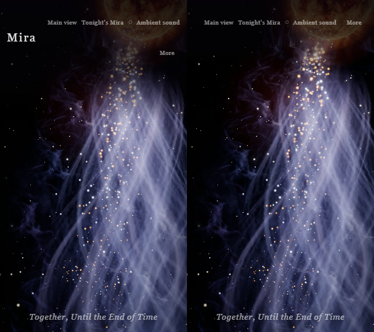
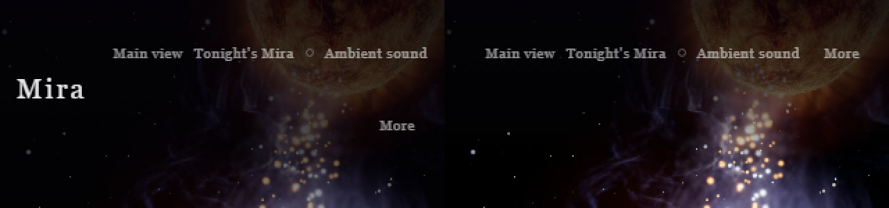

# #149 顶栏在 320 宽的英文界面排成一行：前后对比证据

改动前是 master `4d82caf`，改动后是本 PR。只有原本会折行的画面变了。320 宽的中文和 390 宽的英文，前后逐像素相同。

## 改了什么

左边的「Mira」字样在控件和它放不下同一行时让位。放得下时它一直在，连它们之间的空隙也和改动前一样。判断按实际量得的宽度做，没有写死的阈值。顶栏在布局之后量一遍控件的宽度、它们之间的间距和字样的宽度，再和两侧留白之间的宽度比。控件增减、切换语言、窗口变大变小，都会重量。

## 怎么拍的

全部由 `experiments/bar-row-evidence.mjs` 生成，命令在最后。运行的原样输出都在这个文件夹里。

- **排版表。** 两份生产构建各由 `serve-dist.mjs` 提供服务。320、360、375 和 390 四种宽度，中文和英文，镜头离开主视角、四个控件都在一行时。先量页面本来的状态，再把环境音开关的每一种文字换进去各量一次。每个构建 40 个格子。
- **截图。** 走 `experiments/baseline-harness.mjs` 的同一套流程，冻结时间与镜头，纪元 `2026-04-10T12:00:00Z`，和 #137 的证据同一个纪元。拍之前拖拽一次，让「今晚的 Mira」进入顶栏。英文是在「更多」面板里切过去的。dpr 1。
- **对比度。** 量法同 `docs/evidence-137/README.md`。对每个标签的每个字形像素，取它背后那一像素，算标签颜色（白，55% 不透明度）压在它上面的 WCAG 对比度，取中位数。

## 320×568，英文界面，near 机位

左是改动前，右是改动后。



顶栏放大两倍，看得清标签。



- 改动前顶栏高 128 像素，排成两行，「More」落在第二行。衬底跟着顶栏，也高。
- 改动后顶栏高 76 像素，四个控件排成一行，「Mira」字样让位。衬底也变矮。
- 四个标签的对比度中位数，改动前是 6.26、6.25、5.83、6.26，改动后是 6.26、6.26、5.47、5.70。没有一个字形像素低于 4.5:1。「环境音」和「更多」换了位置，落在衬底较浅的地方，所以低了一些，仍在底线之上。

没有变化的两个画面，见 `shots-run.txt`。320 宽的中文界面顶栏 76 像素，一行，「Mira」字样在。390 宽的英文界面同样。两张参考图是 [320 宽中文](portrait320-near-zh.jpg) 和 [390 宽英文](portrait390-near-en.jpg)。

## 排版表

每个构建 40 个格子。排成两行的格子，改动前有 17 个，改动后有 4 个。数字取自 `layout-run.txt`。表里每个格子按文字状态写，页面本来的状态和平时的文字是同一格。

| 宽度 | 语言 | 环境音开关的文字 | 改动前 | 改动后 | 改动后的字样 |
| --- | --- | --- | --- | --- | --- |
| 320 | 中文 | 环境音 | 1 行 | 1 行 | 在 |
| 320 | 中文 | 点按开启环境音 | 2 行 | 1 行 | 让位 |
| 320 | 中文 | 正在开启环境音… | 2 行 | 1 行 | 让位 |
| 320 | 中文 | 重试环境音 | 2 行 | 1 行 | 让位 |
| 320 | 英文 | Ambient sound | 2 行 | 1 行 | 让位 |
| 320 | 英文 | Tap to start ambient sound | 2 行 | 2 行 | 让位 |
| 320 | 英文 | Starting ambient sound… | 2 行 | 2 行 | 让位 |
| 320 | 英文 | Retry ambient sound | 2 行 | 2 行 | 让位 |
| 360 | 中文 | 环境音、点按开启环境音、重试环境音 | 1 行 | 1 行 | 在 |
| 360 | 中文 | 正在开启环境音… | 2 行 | 1 行 | 让位 |
| 360 | 英文 | Ambient sound | 1 行 | 1 行 | 在 |
| 360 | 英文 | Tap to start ambient sound | 2 行 | 2 行 | 让位 |
| 360 | 英文 | Starting ambient sound… | 2 行 | 1 行 | 让位 |
| 360 | 英文 | Retry ambient sound | 2 行 | 1 行 | 让位 |
| 375 | 中文 | 四种文字 | 1 行 | 1 行 | 在 |
| 375 | 英文 | Ambient sound | 1 行 | 1 行 | 在 |
| 375 | 英文 | Tap to start ambient sound | 2 行 | 1 行 | 让位 |
| 375 | 英文 | Starting ambient sound… | 2 行 | 1 行 | 让位 |
| 375 | 英文 | Retry ambient sound | 2 行 | 1 行 | 让位 |
| 390 | 中文 | 四种文字 | 1 行 | 1 行 | 在 |
| 390 | 英文 | Ambient sound | 1 行 | 1 行 | 在 |
| 390 | 英文 | Tap to start ambient sound | 2 行 | 1 行 | 让位 |
| 390 | 英文 | Starting ambient sound… | 2 行 | 1 行 | 让位 |
| 390 | 英文 | Retry ambient sound | 1 行 | 1 行 | 在 |

360 和 375 这两种宽度，平时的文字都是一行，字样都在，和改动前一样。字样只在那几句很长的英文状态文字出现时让位，那几句在改动前本来就会折行。

还剩两行的 4 个格子是同一件事。环境音开关的三句长状态文字，在 320 宽的英文界面下放不下，其中 `Tap to start ambient sound` 在 360 宽下也放不下。320 宽时四个控件加间距要 309 到 339 像素，可用的是 296 像素。没有字样也放不下，只能缩短这几句英文。那是文案上的决定，另见 #151。

环境音开关的文字状态是直接换进文本节点模拟的，不是走到那几个状态。明细在 `layout-run.txt`。

## 重跑

```
npm run build   # 在两个检出里各跑一次
node experiments/bar-row-evidence.mjs layout <改动前的 dist> <改动后的 dist> <输出目录>
node experiments/bar-row-evidence.mjs shots <改动前的检出> <改动后的检出> <输出目录>
node experiments/bar-row-evidence.mjs contrast <检出> <输出目录>
```

`layout` 用 43401 和 43402 两个端口。`shots` 和 `contrast` 自己找空闲端口起开发服务器。
